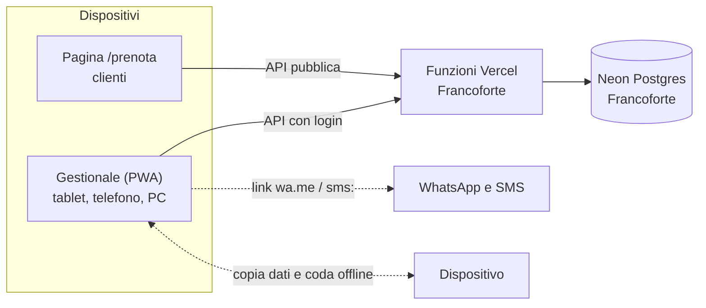

<p align="center">
  
</p>

<h1 align="center">Salone PRO</h1>

<h3 align="center">Gestisci il tuo salone in un click.</h3>

<p align="center">
  Gestionale per parrucchieri con prenotazione online, promemoria su WhatsApp e funzionamento offline.<br>
  <sub>Salon management web app for hair salons: online booking, WhatsApp reminders, works offline. Italian UI.</sub>
</p>

<p align="center">
  <a href="https://github.com/the0x1d3/FlavioSalone/actions/workflows/test.yml"></a>
  
  
  
  
  <a href="LICENSE"></a>
</p>

<p align="center">
  
</p>

Salone PRO nasce da un gestionale in un singolo file HTML che salvava tutto nel browser del tablet. Ora i dati stanno in un database online, le clienti prenotano da sole con gli orari liberi in tempo reale e il salone continua a lavorare anche quando manca internet.

| Indirizzo | Cosa c'è |
|---|---|
| `/` | Gestionale del salone (agenda), protetto da password e installabile come app |
| `/listino` `/clienti` `/magazzino` | Sezioni del gestionale, ognuna con il suo link |
| `/prenotazione-web` `/privacy` `/impostazioni` | Link per le clienti, privacy e GDPR, impostazioni e backup |
| `/prenota` | Pagina pubblica di prenotazione da condividere con le clienti |

## Funzioni

**Agenda**
- In cima il riepilogo di oggi: saluto, appuntamenti e incasso previsto, chi è in poltrona e chi arriva dopo (tra quanto), clienti da richiamare e prodotti da riordinare.
- Vista Giorno, Settimana e Mese, con numero di appuntamenti e incasso del periodo.
- Promemoria delle clienti di oggi, domani e dopodomani da avvisare, con stato "Avvisata".
- Durata dei servizi, orari di fine calcolati e avviso degli appuntamenti sovrapposti.
- Pausa pranzo, ferie e festivi visibili in agenda e bloccati sulla pagina di prenotazione.
- Appuntamenti nel calendario del telefono (Google Calendar, quindi Android) con un link privato in formato iCalendar.

**Clienti e listino**
- Scheda cliente con formule colore, note, allergie (con consenso art. 9 GDPR), consenso privacy, spesa totale e storico delle visite.
- Foto nella scheda (prima e dopo, colore), ridotte a 480p sul dispositivo: circa 50 KB l'una.
- Importa ed esporta le clienti in CSV (Excel): riconosce il nostro formato, le liste "Nome; Cognome; Telefono", i contatti Google e i file senza intestazione; esclude chi non ha telefono e aggiorna le clienti già presenti (stesso nome e stesso numero).
- Selezione multipla ed eliminazione in blocco, con il filtro "Senza telefono" per fare pulizia.
- Lista "Da richiamare": chi non viene da N settimane e non ha appuntamenti, con messaggio WhatsApp già scritto.
- Listino a cartelle (PIEGA, TAGLIO, COLORE...) da creare, rinominare ed eliminare; servizi modificabili.
- Magazzino con soglia minima e avviso dei prodotti da riordinare.

**Prenotazione online**
- Le clienti scelgono servizi, giorno e orario: gli orari occupati sono bloccati in base alla durata.
- Giorni di chiusura, pausa pranzo, ferie, orari e intervallo degli slot si impostano dal gestionale.
- Nella conferma la cliente aggiunge l'appuntamento al suo calendario: Calendario Google (link ufficiale "aggiungi a Google Calendar") oppure il file .ics, che si apre nel Calendario su iPhone, nel Calendario Samsung su Android e in Outlook su computer; promemoria 2 ore prima. L'app Google Calendar per Android non importa file .ics, per questo il pulsante Google resta.
- Ogni prenotazione arriva in agenda con il badge "Web" e, con il gestionale aperto, entro 20 secondi suona un bip con un avviso; due clienti non possono prendere lo stesso orario.

**SMS automatici e notifiche**
- SMS di conferma appena l'appuntamento è preso (anche online) e promemoria il giorno prima, dal telefono del salone con la sua SIM: su Android con l'app gratuita SMS Gateway (sms-gate.app, modalità Cloud server), su iPhone con un'automazione di Comandi Rapidi. Testi personalizzabili, stato di ogni SMS in Impostazioni, mai inviato due volte.
- Notifiche push sul telefono del salone anche ad app chiusa: nuove prenotazioni online e riepilogo del mattino (su iPhone serve l'app installata sulla schermata Home).

**WhatsApp senza API**
- Conferme, promemoria e messaggi liberi con un tocco tramite link `wa.me` (anche via SMS).
- La cliente può mandare la richiesta su WhatsApp e il salone la inserisce in agenda incollando il messaggio.

**App e offline**
- Configurazione guidata alla prima installazione: dati del salone, orari, listino e link per le clienti in 4 passi.
- PWA installabile su tablet, telefono e computer. Tema chiaro, scuro o automatico (segue il dispositivo), da scegliere in fondo al menu e alla pagina di prenotazione.
- Guide passo passo dentro l'app per attivare SMS automatici e notifiche su Android, iPhone e computer.
- Senza rete si apre lo stesso: le modifiche restano sul dispositivo e partono da sole al ritorno della connessione.

## Screenshot

| Settimana | Mese |
|---|---|
|  |  |
| **Listino a cartelle** | **Schede clienti** |
|  |  |
| **Prenotazione online** | **Tema scuro** |
|  |  |
| **Configurazione guidata** | **Dati del salone** |
|  |  |

<p align="center">
  
  &nbsp;&nbsp;
  
</p>

<sub>Dati, nomi e numeri di telefono negli screenshot sono di fantasia.</sub>

## Come funziona



- **Frontend:** HTML, CSS e JavaScript senza framework né build. Font Geist e icone Phosphor ospitati sul sito e ridotti ai caratteri usati.
- **Backend:** funzioni serverless Node su Vercel (`login`, `data`, `public`, `calendar`, `notify`, `cron`) nella regione `fra1`; `cron` gira ogni mattina (promemoria SMS, riepilogo push, pulizia).
- **Database:** Neon Postgres (piano gratuito), una sola tabella `docs (col, id, data jsonb)` creata da sola alla prima richiesta.
- **Test:** le API girano davvero su un Postgres in memoria (PGlite), senza account né rete.

```
public/            gestionale (index.html), prenotazione (prenota.html): solo markup, niente script dentro le pagine
  base.css         stili comuni; admin.css e prenota.css quelli di ciascuna pagina
  common.js        funzioni condivise (date, euro, WhatsApp, informativa privacy, pulsanti data-click)
  offline.js       logica offline: coda delle modifiche e sovrapposizioni
  history.js       storico visite e lista "Da richiamare"
  csv.js           import ed export delle clienti in CSV
  js/              il gestionale diviso per sezione (app, api-sync, novita, agenda, listino, clienti,
                   magazzino, impostazioni, avvio) e la pagina di prenotazione (prenota.js)
  sw.js            service worker: pagine dalla rete, cache come riserva
api/               funzioni serverless (sessione, dati del gestionale, prenotazioni pubbliche, calendario, SMS e notifiche, lavoro del mattino)
test/              test delle API, della logica offline e dello storico, test nel browser (npm test)
docs/screenshots/  immagini di questo README
legacy/            la versione originale in un solo file HTML (v6)
```

## Installazione

[](https://vercel.com/new/clone?repository-url=https%3A%2F%2Fgithub.com%2Fthe0x1d3%2FFlavioSalone&project-name=salone-pro&repository-name=salone-pro&env=ADMIN_PASSWORD&envDescription=Password%20del%20gestionale%2C%20almeno%2010%20caratteri&stores=%5B%7B%22type%22%3A%22integration%22%2C%22integrationSlug%22%3A%22neon%22%2C%22productSlug%22%3A%22neon%22%2C%22protocol%22%3A%22storage%22%7D%5D)

1. **Deploy con un clic:** il pulsante qui sopra copia il repository, crea il progetto e **crea anche il database Neon** (scegli piano **Free** e regione **Frankfurt**), collegandolo da solo con `DATABASE_URL`.
2. **Password:** nella stessa schermata ti chiede `ADMIN_PASSWORD` (almeno 10 caratteri, meglio una frase lunga).
3. **Senza pulsante:** importa il repository su [vercel.com/new](https://vercel.com/new) con Framework Preset **Other**, aggiungi `ADMIN_PASSWORD`, poi **Storage > Create Database > Neon** (oppure da terminale `npx vercel integration add neon --plan free_v3 -m region=fra1 -m auth=false`) e fai **Redeploy**.
4. **Primo accesso:** entra nel gestionale con la password (se manca qualcosa, una schermata spiega cosa fare): parte la **configurazione guidata** (nome del salone, WhatsApp, orari, giorni di chiusura, listino e link per le clienti). Si può saltare e riaprire da **Impostazioni & dati**.

5. **SMS e notifiche (facoltativo):** in Vercel aggiungi la variabile `CRON_SECRET` (una frase casuale lunga): senza, il lavoro del mattino (promemoria SMS e riepilogo) non parte. Poi attiva tutto da **Impostazioni & dati**.

Le funzioni girano a Francoforte (`vercel.json`) e il database va creato a Francoforte, così i dati restano in Unione Europea.

### Sviluppo e test

```bash
npm install
npm test
```

`npm test` apre anche le pagine vere in Chrome (deve essere installato sul computer): accesso, agenda, nuovo appuntamento, scheda cliente, impostazioni con il registro errori e prenotazione online, controllando che non ci siano errori né blocchi della Content-Security-Policy.

Per provare il sito in locale senza account: `node test/server.mjs`, poi apri `http://localhost:5173` (password `password-locale-123`, i dati spariscono alla chiusura). Con il database vero: `npx vercel link`, `npx vercel env pull`, `npx vercel dev`.

**Come è fatto il codice del gestionale:** i file di `public/js/` sono script normali che condividono le variabili globali e vanno caricati nell'ordine di `index.html` (`avvio.js` per ultimo). La CSP non permette `onclick` e simili: un pulsante dichiara la sua azione con `data-click="nome"` (o `data-change`, `data-input`, `data-submit`, `data-toggle`, `data-focus`), con l'eventuale argomento in `data-id` o `data-arg`, e la funzione va aggiunta ad `actions` in fondo al file della sua sezione. Il test nel browser segnala le azioni senza funzione.

## Sicurezza

- **Password** solo come variabile d'ambiente `ADMIN_PASSWORD` (tipo Sensitive su Vercel), mai nel codice.
- **Sessione:** cookie HttpOnly, Secure, SameSite=Strict, firmato HMAC-SHA256, valido 30 giorni.
- **Tentativi di login:** dopo 5 password sbagliate quell'IP è bloccato per 15 minuti.
- **Esci da tutti i dispositivi:** invalida subito ogni sessione aperta, per un tablet perso o rubato.
- **Prenotazioni online:** massimo 10 tentativi all'ora per IP, più un campo nascosto anti-bot.
- **API pubblica:** non restituisce mai nomi o telefoni, solo gli orari occupati.
- **Link segreti (calendario, Comandi Rapidi per gli SMS):** contengono una chiave firmata HMAC, perché quelle app non possono fare login; "Esci da tutti i dispositivi" li cambia.
- **SMS e push:** la password del gateway SMS e le chiavi delle notifiche restano nel database, non arrivano mai al browser né nei backup; gli SMS inviati si cancellano da soli dopo 30 giorni. Il lavoro del mattino risponde solo a Vercel Cron (`CRON_SECRET`).
- **Header:** Content-Security-Policy (nessuno script dentro le pagine né verso altri siti, nessuna connessione esterna), anti-clickjacking, HSTS.
- **Dati in UE:** funzioni e database a Francoforte.

Attiva la verifica in due passaggi su GitHub, Vercel e Neon: chi entra in quegli account vede tutti i dati.

## Modalità offline

Il gestionale funziona anche senza internet, se su quel dispositivo è già stato fatto l'accesso almeno una volta con la rete.

- `public/sw.js` tiene in cache pagine e risorse: prima prova la rete, poi la cache. Le API non passano mai dalla cache.
- Dopo ogni caricamento i dati vengono copiati sul dispositivo (`localStorage`, chiave `sp_cache`).
- Le modifiche fatte senza rete, o con la sessione scaduta, finiscono in una coda (`sp_outbox`) e partono in ordine al ritorno della rete.
- Dopo l'invio, gli appuntamenti inseriti offline che si sovrappongono ad altri vengono segnalati e marcati "Sovrapposto".
- Le foto delle clienti non vengono salvate sul dispositivo: si vedono e si caricano solo con la rete.
- "Esci" cancella copia e coda dal dispositivo; una sessione scaduta o revocata cancella la copia appena il dispositivo torna online.

## App installabile

Dopo il login compare un banner: su Android e computer ha il pulsante **Installa**, su iPhone e iPad spiega i passaggi di Safari (Condividi, "Aggiungi alla schermata Home"). La guida completa è in **Impostazioni > Come si installa**.

L'anteprima del link `/prenota` su WhatsApp e social usa `public/og.png` e i meta `og:` di `prenota.html`, che contengono indirizzi assoluti: se colleghi un tuo dominio, aggiornali.

## Novità nell'app

Al primo accesso dopo un aggiornamento il gestionale mostra **Novità di Salone PRO**, riapribile dal menu. Per annunciare un aggiornamento aggiungi una voce in cima all'array `NEWS` in `public/js/novita.js` con un nuovo `v`.

## Portare i dati dalla versione originale

La versione originale (`legacy/salone_pro_v6.html`, e la successiva v9) salvava tutto nel browser del tablet. Aprila su quel dispositivo, usa **Impostazioni & Dati > Scarica Backup**, poi nel nuovo gestionale **Impostazioni & dati > Ripristina da backup**. Il ripristino sostituisce tutti i dati attuali e porta con sé anche le cartelle del listino e lo stato dei promemoria. Le foto delle clienti restano nel database e non sono incluse nel file di backup.

## Limiti noti

- SMS: su Android il telefono del salone deve restare acceso e online, e gli SMS passano dal servizio gratuito sms-gate.app (che vede numero e testo). Su iPhone partono solo all'ora dell'automazione, quindi le conferme non sono immediate. Il promemoria del giorno prima parte verso le 8 (il piano Hobby di Vercel esegue il lavoro una volta al giorno, entro l'ora indicata).
- Le prenotazioni web arrivano entro 20 secondi solo con il gestionale aperto sullo schermo (o subito con le notifiche push attive); in standby o in una scheda nascosta non suona nulla e l'avviso compare quando lo riapri. Le modifiche fatte da altri dispositivi arrivano entro 2 minuti.
- Offline, due dispositivi che modificano la stessa voce si sovrascrivono: vale l'ultima modifica inviata.
- Le icone sono ridotte a quelle usate: aggiungendo una nuova icona (`ph-...`) va rigenerato `public/vendor/phosphor.*`.
- Google Calendar rilegge il link del calendario quando vuole, di solito ogni qualche ora: non è in tempo reale.
- Il registro errori (Impostazioni) è per dispositivo: ogni tablet o telefono vede i suoi. Gli errori del server completi sono nei log di Vercel.
- Le foto non sono nel file di backup: restano solo nel database Neon (0,5 GB gratuiti, qualche migliaio di foto).
- L'informativa privacy è un modello generico: va fatta verificare prima di affidarcisi.
- Il piano Hobby di Vercel è per uso non commerciale: per un'attività serve il piano Pro.

## Licenza

Il codice è rilasciato con licenza [MIT](LICENSE): puoi usarlo, modificarlo e ridistribuirlo, anche per uso commerciale, mantenendo l'avviso di copyright.

Risorse di terze parti incluse in `public/vendor/`:
- font [Geist](https://vercel.com/font) di Vercel, licenza [SIL Open Font License 1.1](public/vendor/LICENSE-geist.txt);
- icone [Phosphor](https://phosphoricons.com), licenza [MIT](public/vendor/LICENSE-phosphor.txt).
